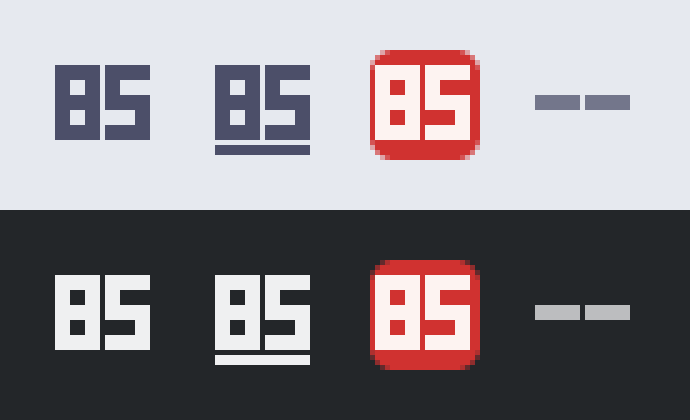

# yeti-gx-tray

A small Rust program that shows the Logitech Yeti GX microphone's **hardware gain**, mute
and Smart Audio Lock state as a KDE Plasma system-tray icon, without G HUB.

The mic's real preamp gain is invisible to Linux audio tools (ALSA only exposes a separate
0–12 digital trim). It is reachable over Logitech HID++ 2.0 on the mic's vendor hidraw
interface; this tool talks to that directly.



*The icon at 22 px, enlarged. Top: light panel, bottom: dark panel.*

- **Icon**: the gain number, drawn to stay legible at 22 px. Every state is distinguishable
  without colour:
  - unmuted: bare digits in the panel's text colour, no tile (the quiet resting state);
  - muted: a solid red tile with the digits knocked out of it; the tray item's status is also
    set to "needs attention";
  - disconnected: two dimmed dashes.

  A bar under the digits means Smart Audio Lock is on.
- **Tooltip**: `Yeti GX — gain 100, unmuted, Smart Lock off` (the tooltip shortens Smart
  Audio Lock to "Smart Lock").
- **Left click**: toggle hardware mute. **Scroll**: gain ±5 per wheel notch (0–100); hi-res
  wheels and touchpads add up to a notch before stepping.
- **Menu**: Mute, Smart Audio Lock, Raise gain (+5), Lower gain (-5), Quit. Everything the
  mouse gestures do is also available as a menu entry, and the menu works from the keyboard
  alone (checked in Plasma 6.8). Smart Audio Lock is greyed out while muted (see Limitations).
- Recovers automatically after unplug/replug.

No Qt, no hidapi: StatusNotifierItem over D-Bus via [`ksni`](https://crates.io/crates/ksni),
and plain `std::fs::File` on the hidraw node. Under 10 MB RSS, 0 CPU when idle.

## Requirements

- **Hardware**: Logitech Yeti GX, USB `046d:0afc`. Only firmware 2.00 has been verified. The
  feature index is discovered at runtime, so another firmware is most likely to differ in
  field behaviour (values, notifications) rather than fail to connect; `--listen` shows what
  it does.
- Linux with a StatusNotifierItem host (Plasma's tray).
- Read/write access to the mic's `/dev/hidrawN`. On a seat-managed desktop this is already
  granted by the `uaccess` udev tag; no udev rule or sudo is needed (verified on CachyOS /
  Plasma 6.8). The node number changes between plugs; it is found at runtime by matching
  `HID_ID=0003:0000046D:00000AFC` in `/sys/class/hidraw/*/device/uevent`.
- Rust toolchain (`cargo`) to build. [mise](https://mise.jdx.dev) drives the tasks; plain
  `cargo` works too.

## Install

Nothing is installed automatically. Build, check and run from the repo first:

```sh
mise run check      # clippy -D warnings, tests, release build
mise run run        # build + run the tray
```

Without mise: `cargo build --release && target/release/yeti-gx-tray`.

To install for your user and start on login:

```sh
mise run install                    # digit colour follows the Plasma colour scheme
YETI_FG='#4c4f69' mise run install  # or pin the digit colour (see Usage)
```

This copies the binary to `~/.local/bin/yeti-gx-tray` and writes
`~/.config/autostart/yeti-gx-tray.desktop` with the binary's absolute path in `Exec=`.
Plasma starts autostart entries as systemd user units, whose `PATH` does not include
`~/.local/bin`, so a bare `Exec=yeti-gx-tray` would not be found.

To uninstall, choose Quit in the tray menu (or `pkill yeti-gx-tray`), then delete those two
files.

## Usage

```
yeti-gx-tray              run the tray icon
yeti-gx-tray --fg #rrggbb run the tray icon with a fixed digit colour
yeti-gx-tray --listen     print every raw HID++ report from the mic with its meaning
yeti-gx-tray --help
```

The digit colour follows the Plasma colour scheme: `ForegroundNormal` in `[Colors:Window]`
of `~/.config/kdeglobals`, re-read within about 2 s of a scheme change. Use `--fg` (the `#`
is optional) when your panel's colour differs from the scheme's window colour. For an
installed copy, reinstall with `YETI_FG` or add `--fg rrggbb` to `Exec=` in the autostart
file.

`--listen` is a debugging aid; see [`--listen` and notifications](#--listen-and-notifications).

## Troubleshooting

Run `target/release/yeti-gx-tray` in a terminal to see its messages. For the autostarted copy:
`journalctl --user -u 'app-yeti\x2dgx\x2dtray@autostart.service'`.

- **No icon appears.** The program waits for a tray host rather than exiting, so there may be
  no error. Check that one is running:
  `busctl --user status org.kde.StatusNotifierWatcher`.
- **`connect failed: Permission denied (os error 13)`, repeated every 2 s.** Your user can't
  open the hidraw node. Find it with
  `grep -l 046D:00000AFC /sys/class/hidraw/*/device/uevent`; `getfacl /dev/hidrawN` should
  list your user with `rw-`. If it doesn't, the `uaccess` tag is missing (for example over
  SSH, or without a seat-managed session).
- **The icon stays on two dashes.** The mic isn't found: it is unplugged, or its `HID_ID`
  differs from the one above (check the `uevent` files).
- **Digits are hard to read against the panel.** Pin the colour with `--fg` (see Usage).

## Limitations

- Multiple instances would show multiple icons; there is no single-instance guard.
- Scroll assumes Plasma's deltas: Qt's 120 per wheel notch, wheel-up positive. A tray host
  that reports ±1 per notch would need 120 notches per step.
- The digit colour assumes the panel background is the scheme's window colour. If it isn't
  (for example a dark Plasma theme with a light scheme), or `kdeglobals` is unreadable and the
  fallback `#eff0f1` (Breeze Dark text) lands on a light panel, the digits can be illegible.
  Use `--fg`.
- The mic ignores a Smart Audio Lock change made while muted: it reads back changed, then
  reverts on unmute (observed on firmware 2.00). The menu entry is therefore disabled while
  muted. Gain changes made while muted do persist.

## `--listen` and notifications

`yeti-gx-tray --listen` (or `mise run listen`) prints every raw report from the mic with a
timestamp and decoded meaning, and sends nothing except the one documented getFeature request
needed to learn the feature index. It can run alongside the tray (hidraw delivers every input
report to every open file descriptor).

Observed on cepheus, firmware 2.00, while using the tray, the knob and the hardware buttons:

| Action | Notification? |
|---|---|
| Turn the knob | **Yes**: `11 ff 0d 20 00 01 <gain>` per step, value = new gain |
| Press the hardware mute button | **Yes**: `... 20 00 00 <0\|1>` (0 = muted, 1 = unmuted) |
| Press the hardware Smart Audio Lock button | **Yes**: `... 20 00 05 <0\|1>` |
| Software write (tray click / scroll / menu) | **No**: only the write reply `... 3d 00 <field> <value>` |

So hardware changes show up on the icon almost instantly, and software writes are picked up
by the re-read the tray does immediately after every write. The 2 s periodic re-read stays as
a safety net.

## Protocol summary

HID++ 2.0 over hidraw, feature `0x8370` (index discovered at runtime; 13 on firmware 2.00).
Short report `0x10` = 7 bytes, long `0x11` = 20 bytes.

```
byte 0  report id (0x10 / 0x11)
byte 1  device index 0xFF
byte 2  feature index
byte 3  (function << 4) | sw_id
byte 4+ params
```

| Request | Bytes |
|---|---|
| getFeature(0x8370) | `10 ff 00 0c 83 70 00` → reply byte 4 = feature index |
| read field | `10 ff <idx> 2<sw> 00 <field> 00` → reply value at byte 7 |
| write field | `10 ff <idx> 3<sw> 00 <field> <value>` |

| Field | Access | Values |
|---|---|---|
| `0x00` mute | r/w | `0` muted, `1` unmuted |
| `0x01` gain | r/w | `0`–`100` |
| `0x02` Smart Audio Lock | r | `0` off, `1` on |
| `0x05` Smart Audio Lock | w | `0x06` off, `0x07` on |

Only these requests are ever sent. Replies are matched by feature index + function + sw id
(reads use sw id `0x0C`, writes `0x0D`); everything else is ignored. Notifications are
`11 ff <idx> 20 00 <type> <value>` with type `0x00` mute, `0x01` gain, `0x05` Smart Audio
Lock. Errors are `10 ff ff <feat> <func|sw> <code> 00`.

Protocol reverse-engineered by:

- <https://github.com/hicham-bouchikhi/yeti-gx-linux>
- <https://github.com/paul-utley/yeti-gx-linux-ui>

## Design

One worker thread owns the device. A reader thread per open device blocks in `poll(2)` on
the hidraw fd (1 s wake-up only to notice shutdown) and forwards reports over a channel; the
worker also receives tray commands on the same channel. Any notification marks the state
dirty and one burst-coalesced re-read of all three fields follows. On read error the icon
switches to the disconnected dashes and the worker rescans `/sys/class/hidraw` every 2 s,
re-discovering the feature index on reconnect.

Tray callbacks only enqueue commands, so the D-Bus thread never blocks on the device.

The icon is rendered in software (`src/icon.rs`) at 16, 22, 24, 32, 48 and 64 px with a 3x5
bitmap font; no image or font dependency. Unless `--fg` is given, a 2 s stat of `kdeglobals`
in a separate thread repaints the icon when the Plasma colour scheme changes.

Further docs in this repo:

- [`PLAN.md`](PLAN.md): the original spec and acceptance criteria.
- [`PRODUCT.md`](PRODUCT.md): who the icon is for and the principles behind it.
- [`DESIGN.md`](DESIGN.md): the icon's visual system (colours, digit font, states, rules).
